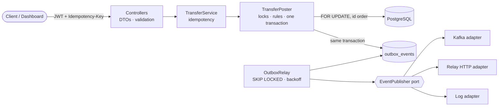

# Wallet Ledger

Double-entry wallet ledger API: accounts, deposits, withdrawals, transfers and reversals that stay correct under concurrent requests and client retries.

[](https://github.com/Tutzdev/wallet-ledger/actions/workflows/ci.yml)


## The problem

Moving money looks like `balance = balance - amount`. It breaks as soon as real traffic arrives:

- Two requests that read the same balance at the same time both pass the "enough funds?" check, and the account goes negative.
- A mobile client times out, retries, and the customer is charged twice.
- A row is edited to "fix" a mistake, and nobody can explain the history anymore.
- The database commits, the message to the rest of the company is lost, and other systems never find out.

This project solves each of these the way payment systems do, and proves it with tests against a real PostgreSQL.

## Backend highlights

- **Double-entry bookkeeping.** Every transfer writes one debit and one credit of the same amount. An account has no balance column: its balance is the sum of its entries, so there is no second number that can drift.
- **Concurrency without lost updates.** Both accounts are locked with `SELECT ... FOR UPDATE` before the funds check. Locks are always taken in id order, so `A → B` and `B → A` running at the same time can never deadlock.
- **Idempotent API.** Every money-moving call requires an `Idempotency-Key`. A retry returns the original transfer (`200` + `Idempotent-Replayed: true`). The same key with a different payload is rejected. Races between identical retries are settled by a unique constraint.
- **Append-only history.** PostgreSQL triggers reject `UPDATE` and `DELETE` on `transfers` and `ledger_entries`. A mistake is fixed with a reversal, which is a new transfer in the opposite direction.
- **Transactional outbox.** The event is stored in the same transaction as the transfer and published afterwards by a poller that uses `FOR UPDATE SKIP LOCKED`, so several instances can drain it in parallel. Publishing is behind a port with three adapters: Kafka, [webhook-relay](https://github.com/Tutzdev/webhook-relay) over HTTP, or the log.
- **Integrity check.** `GET /api/v1/ledger/integrity` proves the invariant: every transfer, and the whole ledger per currency, sums to zero.
- **Exact money.** Amounts are `long` minor units (cents). A decimal is converted once with `RoundingMode.UNNECESSARY`, or rejected.
- **Errors as Problem Details (RFC 9457)** with a stable `code` (`INSUFFICIENT_FUNDS`, `ACCOUNT_FROZEN`, `IDEMPOTENCY_KEY_REUSED`...) that clients can branch on.
- **Security.** Stateless JWT (HS256, issuer validated), BCrypt passwords, a login that takes the same time for unknown e-mails, the first admin created from environment variables, and an app that refuses to start with a JWT secret shorter than 32 characters.
- **Observability.** Actuator health probes, Prometheus metrics, `ledger_transfers_posted_total{type}` and the `ledger_outbox_pending` gauge.

## Business rules

| Rule | Where it is enforced | Error code |
| --- | --- | --- |
| A customer balance never goes below zero | `TransferPoster`, after the row locks are held | `INSUFFICIENT_FUNDS` |
| Both sides of a transfer use the same currency | `TransferPoster` | `CURRENCY_MISMATCH` |
| A frozen account can receive money but cannot send it | `TransferPoster` | `ACCOUNT_FROZEN` |
| Reversals still run on frozen accounts (back-office correction) | `TransferPoster` | n/a |
| A transfer can be reversed once, and a reversal cannot be reversed | `TransferPoster` + `UNIQUE (reversal_of_id)` | `ALREADY_REVERSED`, `NOT_REVERSIBLE` |
| A reversal needs funds too: it never makes a customer balance negative | `TransferPoster` | `INSUFFICIENT_FUNDS` |
| An Idempotency-Key is bound to one request | `TransferService` + `UNIQUE (created_by, idempotency_key)` | `IDEMPOTENCY_KEY_REUSED` |
| At most 2 decimal places, amount greater than zero | `Money` | `INVALID_AMOUNT` |
| Transfers and entries are never edited or deleted | PostgreSQL triggers (`V3` migration) | n/a |
| System accounts (money outside the ledger) may be negative and cannot be frozen | `Account` | `SYSTEM_ACCOUNT` |

## Architecture



A deposit, from request to event:

1. `TransferService` looks up the `Idempotency-Key`. If it was used before, it returns the original transfer.
2. `TransferPoster` opens a transaction, locks the customer account and the system account in id order, and checks the rules against the locked state.
3. It inserts the transfer, a debit on the system account and a credit on the customer account, and the outbox event. All of them commit together.
4. If a retry with the same key raced and lost on the unique constraint, its transaction rolls back and it answers with the winner's transfer.
5. Within about a second, `OutboxRelay` publishes `deposit.posted` and marks the row. If the broker is down, it retries with exponential backoff.

```
src/main/java/dev/tutz/ledger
├── account     Account aggregate, status changes, balance queries
├── transfer    Transfer, LedgerEntry, TransferPoster (write path), TransferService (idempotency), statement
├── outbox      OutboxEvent, OutboxRelay, EventPublisher port + Kafka / Relay / log adapters
├── report      Integrity check and dashboard summary (plain SQL via JdbcClient)
├── auth        Operators, JWT issuing, Spring Security config
├── money       Money value object, CurrencyCode
└── common      Problem Details handler, pagination, exceptions
```

## API

All endpoints except `POST /api/v1/auth/token` require `Authorization: Bearer <token>`. OpenAPI UI: `/swagger-ui.html`.

| Method | Path | Description |
| --- | --- | --- |
| `POST` | `/api/v1/auth/token` | Exchange e-mail and password for a JWT |
| `POST` | `/api/v1/accounts` | Open a customer account (`BRL`, `USD`, `EUR`) |
| `GET` | `/api/v1/accounts` | List accounts with balances (paginated, `type=CUSTOMER\|SYSTEM`) |
| `GET` | `/api/v1/accounts/{id}` | Account with its current balance |
| `PATCH` | `/api/v1/accounts/{id}/status` | Freeze or unfreeze |
| `GET` | `/api/v1/accounts/{id}/entries` | Statement: signed entries, newest first |
| `POST` | `/api/v1/deposits` | Deposit (requires `Idempotency-Key`) |
| `POST` | `/api/v1/withdrawals` | Withdrawal (requires `Idempotency-Key`) |
| `POST` | `/api/v1/transfers` | Transfer between two accounts (requires `Idempotency-Key`) |
| `POST` | `/api/v1/transfers/{id}/reversal` | Reverse a transfer with a reason (requires `Idempotency-Key`) |
| `GET` | `/api/v1/transfers` | List transfers, optionally filtered by `accountId` |
| `GET` | `/api/v1/transfers/{id}` | One transfer |
| `GET` | `/api/v1/ledger/integrity` | Double-entry invariant check |
| `GET` | `/api/v1/ledger/summary` | Numbers for the dashboard |

```bash
curl -X POST localhost:8080/api/v1/transfers \
  -H "Authorization: Bearer $TOKEN" \
  -H "Idempotency-Key: 6f1c2b7e-checkout-42" \
  -H "Content-Type: application/json" \
  -d '{"sourceAccountId":"…","destinationAccountId":"…","amount":40.50,"description":"Dinner"}'
```

```json
{
  "type": "about:blank",
  "title": "Unprocessable Content",
  "status": 422,
  "detail": "Account 5736b138-… has insufficient funds.",
  "instance": "/api/v1/transfers",
  "code": "INSUFFICIENT_FUNDS",
  "timestamp": "2026-10-08T17:53:29.968Z"
}
```

## Technical decisions

- **Pessimistic locks instead of optimistic versioning.** Money on the same account is a hot spot. With `@Version`, concurrent requests fail and the client has to retry. With a row lock they queue for a few milliseconds and all succeed. The lock is held only for the posting transaction.
- **Balance as `SUM(entries)` instead of a balance column.** The history is the single source of truth. The sum is indexed by `(account_id, created_at)`. At very high volume, the next step is a balance snapshot updated in the same transaction, which the integrity check would then verify.
- **Idempotency in the `transfers` table itself.** It needs no extra table and no TTL job, and the unique constraint `(created_by, idempotency_key)` settles races. The fingerprint (SHA-256 of the request) catches a key reused for a different payload.
- **Outbox instead of publishing inside the transaction.** Sending to Kafka inside `@Transactional` either loses the event when the commit fails, or sends one that never happened. The outbox gives at-least-once delivery, and consumers deduplicate by the event id, which is sent as a header to Kafka and as `idempotency_key` to Relay. Transfer events also carry the `Idempotency-Key` of the request that created them, so a client whose HTTP call timed out can still recognise its own transfer when the event arrives ([seat-reservation](https://github.com/Tutzdev/seat-reservation) settles payments this way).
- **Ports and adapters only where they pay off.** Event publishing has three real implementations, so it gets a port. Persistence uses Spring Data directly, because a repository interface over a repository interface adds nothing.
- **Plain SQL on the read side.** The dashboard aggregates use `JdbcClient` and never load entities.

## Tests

```bash
./mvnw verify   # needs Docker for Testcontainers
```

- `TransferConcurrencyTests`: 50 simultaneous transfers of 10.00 from an account holding 100.00. Exactly 10 succeed, the balance ends at zero and the ledger stays balanced. A second test runs 40 opposite transfers (`A → B` and `B → A`) at once without a deadlock.
- `TransferServiceTests`: idempotent retry, a key reused with a different payload, 10 concurrent retries with the same key moving the money once, reverse-once, and the frozen-account rules.
- `MoneyTest`: exact decimal conversion and rejection of fractions of a cent.

The integration tests run against PostgreSQL 17 in Testcontainers, because row locks, `SKIP LOCKED` and the append-only triggers cannot be faked by an in-memory database. CI runs everything on every push.

## Running locally

```bash
cp .env.example .env          # set LEDGER_JWT_SECRET and the admin password
docker compose up --build     # PostgreSQL + Kafka + app on :8080
```

Without Docker, start a PostgreSQL database `ledger` (user and password `ledger`) and run:

```bash
LEDGER_JWT_SECRET=change-me-to-a-random-string-with-32-chars-or-more \
LEDGER_ADMIN_EMAIL=admin@ledger.dev LEDGER_ADMIN_PASSWORD=change-me-please \
./mvnw spring-boot:run
```

`LEDGER_EVENTS_PUBLISHER` picks the adapter: `log` (default), `kafka` or `relay` (with `RELAY_URL` and `RELAY_API_KEY`).

## Interface

A back-office dashboard (plain HTML, CSS and JS served by Spring at `/`) covers sign-in, the overview numbers, accounts with statements, freeze and unfreeze, moving money with a visible Idempotency-Key, and reversals.

## Next steps

- Balance snapshots per account for very high volume.
- Rate limiting on `/auth/token`.
- Refresh tokens and per-operator roles (viewer and operator).
- An expiry for idempotency keys and outbox rows already published.
